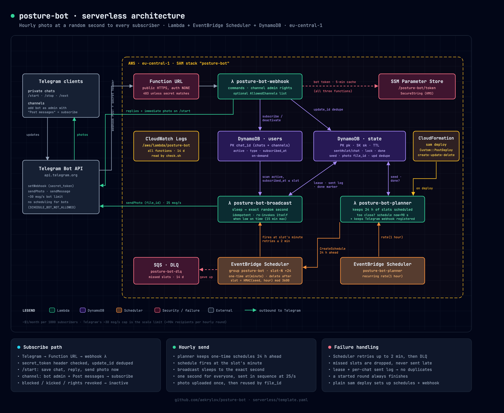

# posture-bot

Telegram bots that post a picture to every subscriber once an hour, at a random second. Each bot has its own picture, set by its admins, and posts to private chats and channels.

There are two versions:

- **`serverless/`, AWS (recommended):** any number of bots, managed from a super-admin Telegram bot. Runs on Lambda, EventBridge Scheduler, DynamoDB and SSM, and costs about $1/month per 1000 subscribers.
- **`bot.py`, one bot on your own machine:** Python standard library only. A laptop that sleeps misses posts, so it's best on an always-on box.



## Deploy on AWS

### You need

- an AWS account and the [AWS CLI](https://docs.aws.amazon.com/cli/latest/userguide/getting-started-install.html), logged in (`aws sts get-caller-identity` works)
- the [SAM CLI](https://docs.aws.amazon.com/serverless-application-model/latest/developerguide/install-sam-cli.html)
- a Telegram account

The region is set in `serverless/samconfig.toml` (`eu-central-1`). Change it there if you want another region.

### 1. Create the bots

In [@BotFather](https://t.me/BotFather), send `/newbot` twice and keep both tokens:

- the **admin bot**, which only you talk to, e.g. `my_posture_admin_bot`
- your first **posture bot**, the one people subscribe to

### 2. Store your ID and the admin token in AWS

Get your Telegram user ID from [@userinfobot](https://t.me/userinfobot). Then store both values yourself; don't paste tokens into chats or files:

```sh
aws ssm put-parameter --name /posture-bot/super-admin --type SecureString --value '<your user id>'
aws ssm put-parameter --name /posture-bot/admin-token --type SecureString --value '<admin bot token>'
```

### 3. Deploy

```sh
cd serverless
sam deploy
```

That's the whole deploy. It creates everything, schedules the next 24 hours and registers the admin bot's webhook. Running `sam deploy` again after a code change updates the stack in place.

### 4. Add your posture bot

Open your admin bot, press **Start**, and send:

```
/addbot <posture bot token>
```

The admin bot checks the token, stores it in AWS, connects the bot and deletes your message so the token doesn't stay in the chat. It replies `@your_bot added. Status: ok`.

### 5. Use it

- **Subscribe:** anyone opens the posture bot and presses **Start**. They get the picture straight away, then once an hour.
- **Post to a channel:** in the channel, open Administrators → Add admin, pick the bot, and leave "Post messages" on. The channel gets the first post straight away. Removing the bot unsubscribes the channel.
- **Change the picture:** send a photo to the posture bot in a private chat. This works for you and the bot's admins. It's used from the next hourly post on.

## Day-to-day

**In the admin bot** (it ignores everyone except you):

- `/bots`: list every bot with its status, subscribers and image
- `/addbot <token>`: add a bot
- `/settoken <token>`: replace a bot's token after revoking it in BotFather
- `/disable <bot>`, `/enable <bot>`: pause or resume a bot's hourly posts
- `/admins <bot> add <user_id>`: let someone else set that bot's picture. Use `del` to remove them; with no arguments it lists the bot's admins.
- `/test <bot>`: send that bot's current picture to you (press Start in that bot first)
- `/removebot <bot>`: remove a bot (it asks you to confirm)

**In a posture bot:**

- Everyone has `/start`, `/stop`, `/next` (time of the next post) and `/id` (your user ID).
- Its admins also have `/image` (show the current picture) and `/stats` (subscriber counts), and set the picture by sending a photo.

**From the AWS console** instead of the admin bot:

- **SSM Parameter Store** has `/posture-bot/bots/<username>/token` and `/admins` for each bot. Creating, editing or deleting these takes effect within seconds.
- **DynamoDB → `posture-bot-bots`** has one item per bot:
  - `enabled`, `caption` and `allowed_channels` can be edited.
  - `status` shows problems such as "invalid token".

**Health check** (never prints tokens):

```sh
serverless/check.sh
```

**Remove everything:** `cd serverless && sam delete`. This deletes the stack, schedules and webhooks. The SSM parameters stay, so delete them yourself if you no longer need them.

## How it behaves

- **Timing:** all bots post at the same random second each hour, and each bot sends at up to 25 messages per second.
- **Missed posts:** if AWS can't start a post within 2 minutes of its time, that hour is skipped and the next one goes out as usual. Late posts are never sent.
- **Subscribers:** users who block a bot are unsubscribed automatically. Channels are unsubscribed when the bot is removed or loses "Post messages".
- **Telegram has no scheduling for bots** (`SCHEDULE_BOT_NOT_ALLOWED`), so the schedule is kept in AWS. One-time EventBridge schedules are created 24 hours ahead, so the system survives a day-long planner outage.

Design details, data layout and tests: [`serverless/README.md`](serverless/README.md).

## Single bot on your own machine

`bot.py` runs one bot with long polling and keeps its data in SQLite.

```sh
cp .env.example .env && chmod 600 .env   # put the BotFather token in it
./run.sh
```

To keep it running and restart it on crashes:

- **macOS:** `cp deploy/org.anth.posture-bot.plist ~/Library/LaunchAgents/ && launchctl bootstrap gui/$(id -u) ~/Library/LaunchAgents/org.anth.posture-bot.plist`
- **Linux:** see `deploy/posture-bot.service`

A bot can't use both versions at once: setting a webhook (AWS) turns off polling (`bot.py`).

## Tests

No Telegram token or AWS account needed:

```sh
python3 test_e2e.py                      # bot.py: fake Bot API, 6-second "hours", simulated crashes
cd serverless && python3.12 -m venv .venv && .venv/bin/pip install 'moto[dynamodb,ssm,scheduler]' boto3
.venv/bin/python test_local.py           # AWS version: moto + fake multi-bot Telegram API
```
